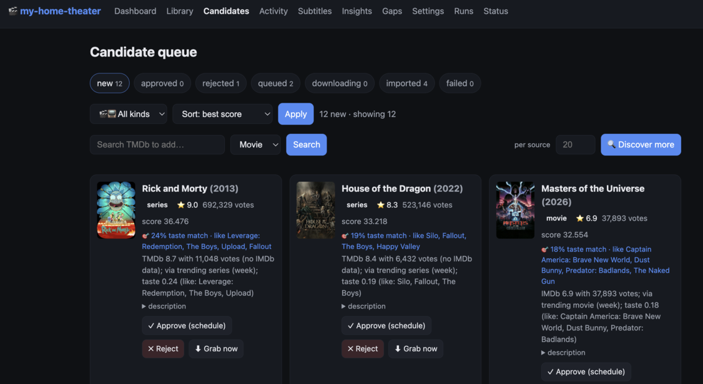

# my-home-theater

Automate a personal movie & TV library end-to-end: scan the NAS, enrich metadata,
discover what's worth adding (rating/vote filtered + learned taste, plus new
seasons of series you own or **follow**), grab it — one click from search, or
automatically for followed shows — import it, fetch subtitles, and drive the
whole thing from an HTML dashboard. Python-first, SQLite-backed, no Docker
required.



## Two ways to run it

The app owns the custom parts (catalog, discovery, taste model, scheduler,
dashboard). How titles are **acquired** and **subtitled** is pluggable:

| Concern | `arr` / `bazarr` (default) | self-contained (native) |
|---|---|---|
| Acquisition | drive Radarr/Sonarr (they own Prowlarr + qBittorrent + import) | search indexers directly → **Transmission** → copy into the NAS layout |
| Subtitles | trigger Bazarr | fetch from **OpenSubtitles** (.com + .org) and **ktuvit** (Hebrew), write into `Subs/` beside the media |

Select per concern in `config.yaml`: `acquisition.backend: arr|torrent` and
`subtitles.backend: bazarr|native`. The self-contained path needs **no** arr
stack — details in [`docs/torrent-backend.md`](docs/torrent-backend.md) and
[`docs/subtitles-native.md`](docs/subtitles-native.md). Working on the code?
Start with [`docs/SKILLS.md`](docs/SKILLS.md).

## Quick start

```bash
python3 -m venv .venv && .venv/bin/pip install -e ".[dev]"   # or: conda env create -f environment.yaml
cp config.example.yaml config.yaml   # NAS paths, thresholds, backends
cp .env.example .env                 # secrets (see below)
.venv/bin/alembic upgrade head       # create the schema
.venv/bin/home-theater               # serve the dashboard at http://localhost:8000
```

Upgrading an install that predates the November 2026 audit? Follow
[`docs/upgrade-2026-11.md`](docs/upgrade-2026-11.md), not the steps above.

**Secrets (`.env`, never committed).** `DASHBOARD_TOKEN` (gates every mutating
action — `python -c "import secrets; print(secrets.token_urlsafe(32))"`;
set `DASHBOARD_REQUIRE_AUTH=true` to also gate the read pages/APIs if you expose
the dashboard beyond a trusted LAN);
`TMDB_API_KEY` + `OMDB_API_KEY`; `SMB_HOST`/`SMB_USER`/`SMB_PASS` for the NAS.
Then per backend: `TRANSMISSION_URL/USER/PASS` (torrent) and/or
`OPENSUBTITLES_*` + `KTUVIT_*` (native subtitles). Optional: `RADARR_*`/`SONARR_*`/
`BAZARR_*`, `TRAKT_*` (watchlist, watched sync), `KODI_USER`/`KODI_PASS`,
`TELEGRAM_*` (alerts, digest).

**Reaching the dashboard.** A request whose `Host` isn't allowed gets a 400.
`server.allowed_hosts` defaults to `localhost`, `127.0.0.1`, `::1` and `*.local`;
this machine's name and (with `server.allow_private_ips`) private or Tailscale IPs
always pass. Add a name there or in `HOME_THEATER_ALLOWED_HOSTS` (comma-separated).
`/docs`, `/redoc` and `/openapi.json` are off unless `HOME_THEATER_DOCS=true`.

## CLI

```bash
home-theater            # serve the dashboard/API (default)
home-theater scan       # NAS -> owned catalog (--force-prune: past the scanner.* limits)
home-theater enrich     # backfill TMDb/IMDb ratings/votes/genres (--force: ignore the retry cooldown)
home-theater discover   # find candidates above your thresholds + new seasons of owned series
home-theater acquire    # grab approved candidates (arr or torrent backend)
home-theater sync       # advance in-flight downloads (poll -> import)
home-theater subtitles  # fetch missing subtitles (bazarr or native backend)
home-theater subtitle-sync  # timing check with ffsubsync (subtitles.sync)
home-theater reconcile  # reconcile arr-owned items into the catalog
home-theater backup     # timestamped SQLite backup
home-theater cleanup    # find NAS extras + stuck torrents (dry run; --apply to remove)
home-theater trash list | restore <id> | purge [--dry-run]   # the NAS trash
home-theater upgrades   # propose better copies of owned movies; never downloads
home-theater repair-titles  # merge series split by filename (dry run; --apply to merge)
home-theater train      # retrain the preference model
home-theater kodi-sync  # read Kodi watch history, send any due library scan
home-theater trakt-sync # pull Trakt watched history (and push, if trakt.sync.push)
```

Everything is also on the dashboard: **Library**, **Candidates** (review/approve,
one-click **⬇ Grab** from TMDb search, **★ Follow** a series to auto-grab new
seasons/episodes), **Activity** (live grab → download → import → subtitles, with
in-app Rescan/Enrich/Sync/Subtitle triggers), **Subtitles**, **Watched** (Kodi and
Trakt state, archive suggestions), **Insights**, **Gaps** (grab what you're missing),
**Inbox** (everything waiting on you, with its fix), **Repair** (split titles, wrong
matches, manual merges), **Storage** (NAS forecast and removal suggestions; read-only),
**Settings**, **Runs**, and **Status** (service and job health, a 🧹 **Cleanup** panel
for NAS extras and stuck torrents, and the 🗑 **Trash**).

## Going live safely

1. `scan` → `enrich`, open the dashboard, check **Status** shows your services **up**.
2. `discover`, then review/approve on **Candidates**.
3. Keep `features.dry_run: true` until you've watched one clean run; then flip it
   off and grab a legal/public-domain title to validate acquire → sync → import.
4. For unattended operation set `schedule.enabled: true`, then on macOS run
   `deploy/install-launchd.sh` (it prints the one manual Full Disk Access step), or
   on Linux install `deploy/home-theater.service`.

You're responsible for your sources and their legality; keep review/dry-run modes
on until you trust the pipeline.

## Develop

```bash
.venv/bin/pytest        # no external services hit
.venv/bin/ruff check .
.venv/bin/black .
.venv/bin/mypy src/homeTheater
.venv/bin/pre-commit install   # once: gitleaks, ruff, black, mypy on commit
```

Schema changes: `alembic revision --autogenerate -m "..."` then `alembic upgrade
head` (SQLite batch mode). `init_db()` covers dev/test and creates missing tables at
every start, but never alters an existing one. Architecture, conventions,
and the hard-won platform gotchas (macOS TCC, SMB mount reliability) are in
[`docs/SKILLS.md`](docs/SKILLS.md); the original design is
[`docs/my-home-theater-plan.md`](docs/my-home-theater-plan.md).
